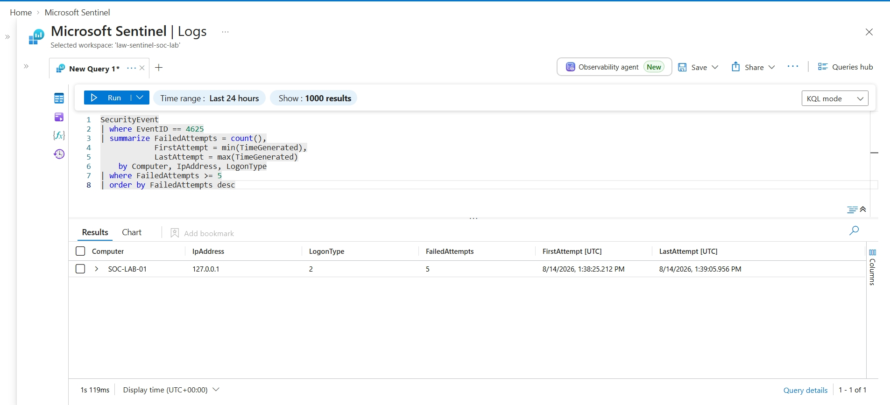
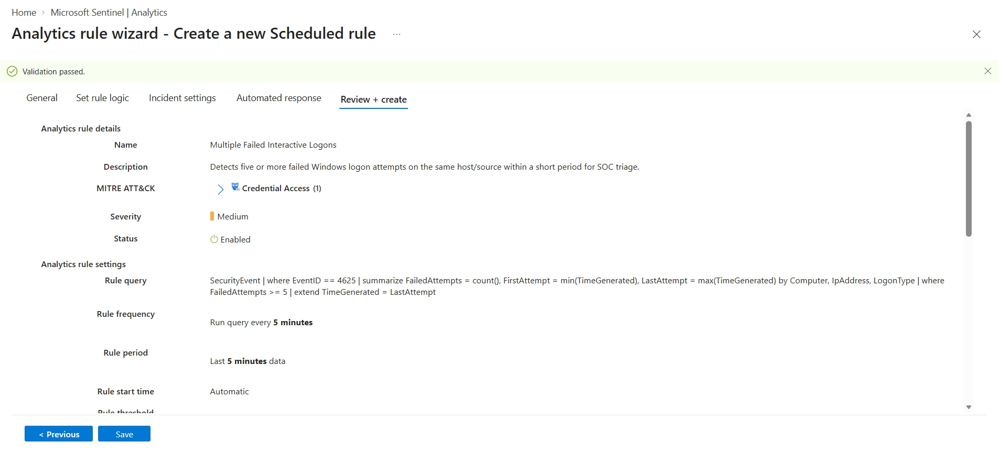
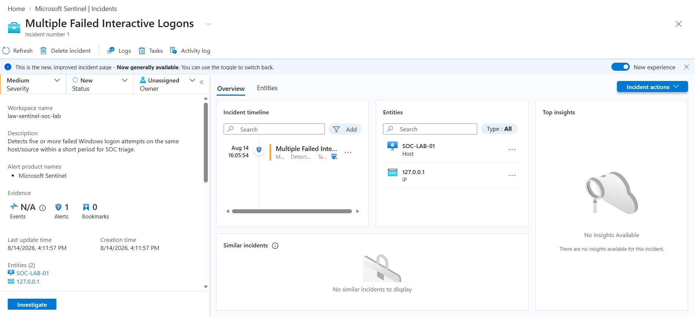
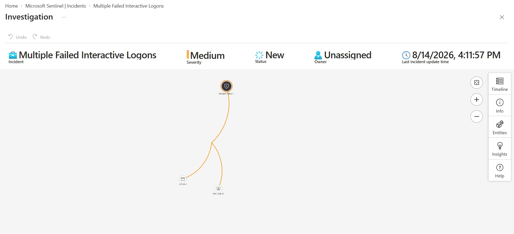
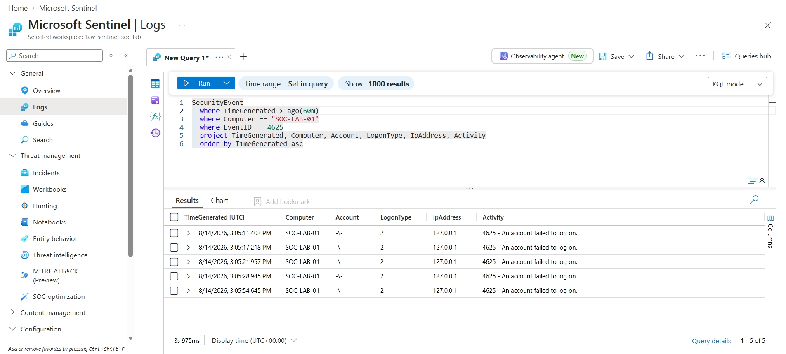
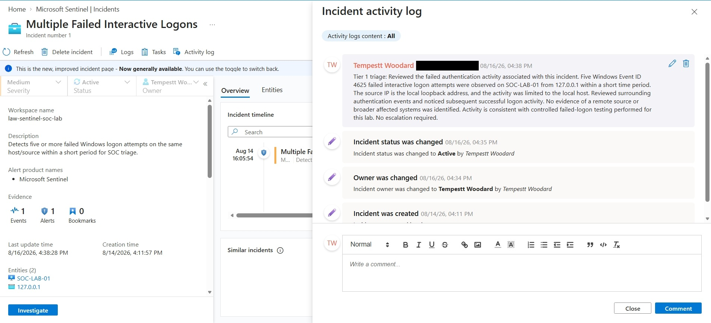
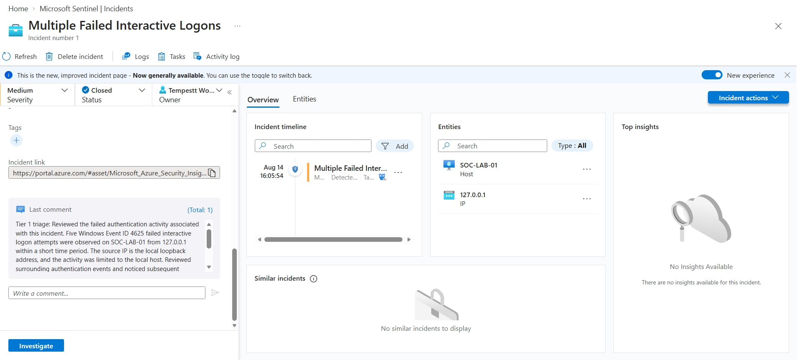

# Microsoft Sentinel SOC Detection & Incident Response Lab

## Overview

This project demonstrates an end-to-end Security Operations Center (SOC) workflow using Microsoft Sentinel, Windows Security Events, Azure Monitor Agent, Log Analytics, and Kusto Query Language (KQL).

I built a lab environment around a physical Windows 11 endpoint, collected Windows security telemetry, developed a custom failed-logon detection, deployed the detection as a scheduled Microsoft Sentinel analytics rule, generated a live security incident, and completed Tier 1 triage through classification and closure.

The project follows the complete SOC workflow:

**Telemetry → Detection → Alert → Incident → Investigation → Analyst Decision → Documentation → Closure**

---

## Architecture

```text
SOC-LAB-01 (Windows 11 Pro)
        |
        | Windows Security Events
        v
Azure Monitor Agent (AMA)
        |
        | Data Collection Rule
        v
Log Analytics Workspace
        |
        v
Microsoft Sentinel
        |
        +--> KQL Analysis
        |
        +--> Scheduled Analytics Rule
        |
        +--> Alert
        |
        +--> Incident
        |
        v
Tier 1 SOC Triage
```

The physical Windows endpoint was onboarded to Azure using Azure Arc. Azure Monitor Agent collected Windows Security Events and forwarded the telemetry to Log Analytics for analysis in Microsoft Sentinel.

[View detailed lab architecture](documentation/lab-architecture.md)

---

## Technologies

- Microsoft Sentinel
- Microsoft Azure
- Azure Arc
- Azure Monitor Agent (AMA)
- Azure Log Analytics
- Windows 11 Pro
- Windows Security Event Logs
- Kusto Query Language (KQL)
- MITRE ATT&CK
- Git / GitHub

---

## Detection Scenario

### Multiple Failed Interactive Logons

I developed a custom detection to identify repeated failed Windows authentication attempts that could indicate password guessing or brute-force behavior.

The detection monitors:

- **Windows Event ID:** 4625: An account failed to log on
- **Threshold:** 5 or more failed attempts
- **Rule frequency:** Every 5 minutes
- **Lookback period:** 5 minutes
- **Severity:** Medium
- **MITRE ATT&CK Tactic:** Credential Access
- **MITRE ATT&CK Technique:** T1110: Brute Force

The query groups failed authentication attempts by computer, source IP address, and logon type before applying the detection threshold.

```kusto
SecurityEvent
| where EventID == 4625
| summarize FailedAttempts = count(),
            FirstAttempt = min(TimeGenerated),
            LastAttempt = max(TimeGenerated)
    by Computer, IpAddress, LogonType
| where FailedAttempts >= 5
| extend TimeGenerated = LastAttempt
```

[View detection documentation](detections/multiple-failed-logons.md)

[View KQL file](kql/failed-logon-detection.kql)

---

## Detection Validation

To validate the detection, I intentionally generated five failed interactive authentication attempts on the Windows lab endpoint.

The resulting Event ID 4625 records were successfully ingested into Log Analytics and identified using KQL.



I then deployed the detection as a scheduled Microsoft Sentinel analytics rule.

The rule included:

- Medium alert severity
- Five-minute query frequency
- Five-minute lookback period
- MITRE ATT&CK Credential Access / T1110 mapping
- Host entity mapping using `Computer`
- IP entity mapping using `IpAddress`
- Automatic Sentinel incident creation
- Entity-based incident grouping



---

## Live Incident Generation

After the analytics rule was enabled, I generated a second controlled set of failed authentication attempts to validate the complete detection pipeline.

Microsoft Sentinel generated a **Medium-severity incident** from the custom analytics rule.



The mapped Host and IP entities were also represented in the Sentinel investigation graph.



---

## Tier 1 Incident Triage

I took ownership of the incident and performed Tier 1 triage.

The underlying Windows Security Event telemetry confirmed:

- Five Event ID 4625 failed authentication attempts
- Affected endpoint: `SOC-LAB-01`
- Source address: `127.0.0.1`
- Logon Type 2: Interactive
- Activity concentrated within a short time period
- No identified remote source or broader affected systems during triage
- Successful local authentication activity occurred shortly after the failed attempts



The investigation findings were documented in the Microsoft Sentinel incident activity log.



---

## Analyst Assessment & Disposition

The detection operated correctly: five failed interactive logon attempts occurred and satisfied the analytics rule threshold.

However, investigation determined that the activity was intentionally generated as part of controlled lab testing and did not represent malicious authentication activity.

The incident was classified as:

**Benign Positive: Suspicious but Expected**

No escalation was required.



[View Incident 001 case report](incidents/incident-001-failed-logons.md)

---

## SOC Workflow Demonstrated

This project demonstrates the lifecycle of a basic SOC detection and investigation:

**Security Telemetry → KQL Analysis → Custom Analytics Rule → Alert → Sentinel Incident → Incident Ownership → Tier 1 Triage → Event & Entity Analysis → Scope Assessment → Analyst Documentation → Classification & Closure**

---

## Repository Structure

```text
Microsoft-Sentinel-SOC-Lab/
│
├── detections/
│   └── multiple-failed-logons.md
│
├── documentation/
│   └── lab-architecture.md
│
├── incidents/
│   └── incident-001-failed-logons.md
│
├── kql/
│   └── failed-logon-detection.kql
│
├── screenshots/
│   └── Sentinel configuration and investigation evidence
│
└── README.md
```

---

## Skills Demonstrated

- Microsoft Sentinel SIEM
- Windows Security Event analysis
- KQL querying and filtering
- Authentication log analysis
- Detection engineering fundamentals
- Scheduled analytics rule configuration
- MITRE ATT&CK mapping
- Sentinel entity mapping
- Alert and incident generation
- Tier 1 SOC incident triage
- Incident scope assessment
- Analyst documentation
- Incident classification and closure
- Azure Arc endpoint onboarding
- Azure Monitor Agent configuration
- Log Analytics telemetry collection

---

## Key Takeaways

This project reinforced the difference between **detection** and **determination**.

A security alert indicates that defined detection conditions were met, but it does not automatically establish malicious activity. The underlying telemetry and surrounding context must be reviewed before determining severity, scope, escalation requirements, and final disposition.

The lab also provided practical experience following security telemetry from its source on a Windows endpoint through collection, detection, alerting, investigation, and final incident closure.
